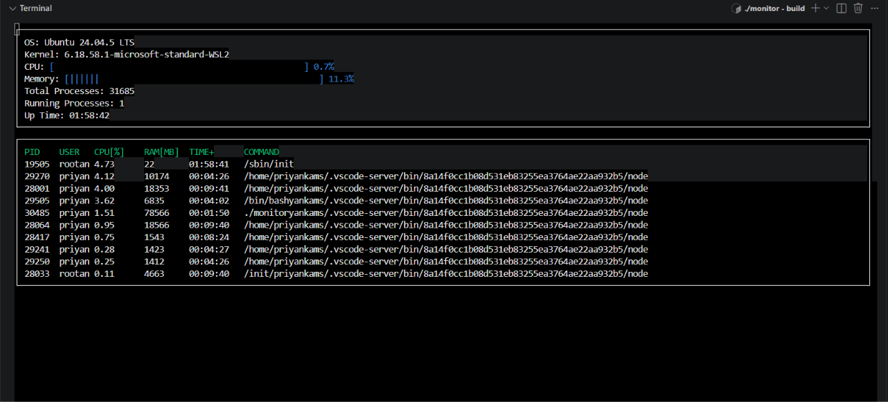

# Linux System Resource Monitor

A C++17-based Linux System Resource Monitoring Tool that displays system information through an interactive terminal dashboard using the **ncurses** library.

This project monitors important Linux system resources, including CPU usage, memory usage, running processes, and system uptime.

## Features

- Displays CPU utilisation.
- Displays memory usage.
- Shows the number of running processes.
- Displays system and kernel information.
- Shows system uptime.
- Lists running processes in an interactive terminal dashboard.
- Supports keyboard exit using `q` and `Q`.

## Technologies Used

- C++17
- Linux
- ncurses
- CMake
- Linux `/proc` filesystem
- C++ Standard Template Library (STL)

## Project Screenshot



## Installation and Build

### 1. Clone the repository

```bash
git clone https://github.com/priyanka-457/linux-system-resource-monitor.git
```

### 2. Open the project directory

```bash
cd linux-system-resource-monitor
```

### 3. Create the build directory

```bash
cmake -S . -B build
```

### 4. Build the project

```bash
cmake --build build -j4
```

### 5. Run the application

```bash
cd build
./monitor
```

Press `q` or `Q` to exit the dashboard.

## Learning Outcomes

- Understanding Linux system information through the `/proc` filesystem.
- Working with C++ classes, objects, and namespaces.
- Using vectors, maps, and string streams.
- Parsing system and process information.
- Understanding CPU and memory utilisation.

## Acknowledgement

This project is based on the original [cpp-linux-system-monitor](https://github.com/nazarja/cpp-linux-system-monitor) project, with modifications and improvements to the implementation and terminal display.